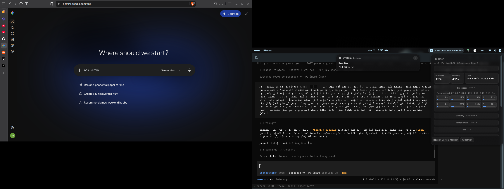
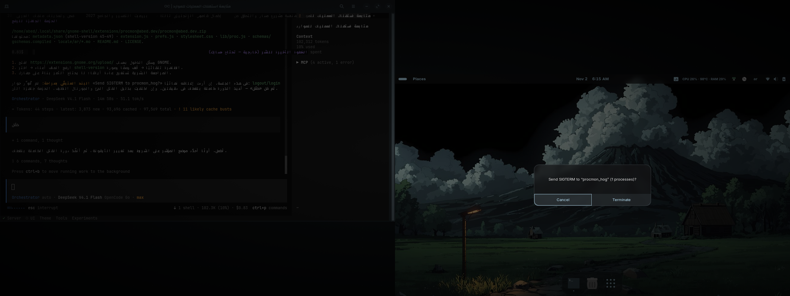

<p align="center">
  
</p>

# ProcMon


A system monitor for the GNOME top panel — CPU, RAM and temperature at a
glance, with a dashboard menu for everything else. Fully async sampling from
`/proc` and `/sys`, no external dependencies, GNOME Shell 45–49 (X11 and
Wayland), English + Arabic.

The visual identity (mark, colour, type, controls) is specified in
[`DESIGN.md`](DESIGN.md) — one idea: *the pulse of the machine*.
Release history: [`CHANGELOG.md`](CHANGELOG.md).

## Features

- **Panel indicator** with configurable items (CPU, temperature, RAM). Each
  item is coloured by its own attention level — amber at 75%, red at 90% —
  so a calm readout never paints a hot one amber.
- **Dashboard menu**: summary cards (CPU / memory / disk-or-GPU) with trend
  arrows, a CPU+RAM history sparkline with a colour legend (blue CPU bars,
  green RAM bars), flat subsections separated by rules, and collapsible
  groups so you see only what you need.
- **Top processes** grouped by CPU and by RAM, with safe termination: left
  click sends SIGTERM, right click sends SIGKILL, after a confirmation
  dialog. Every kill is re-verified against `/proc/<pid>/stat` starttime to
  prevent PID-reuse races, only your own processes can be signaled, and
  supervised processes (systemd services, session apps) say so before you
  kill them — with a one-click "Stop the unit" follow-up if they restart.
- **Sensors**: CPU frequencies (average / max / cores), memory breakdown
  (used / available / cached / buffers / swap), temperatures, fans,
  voltages, battery level, power and time left, network and disk rates,
  GPU usage + VRAM, PSI pressure. Load average shows 1m and 5m in the
  menu header.
- **Smart alerts**: threshold notifications with escalation (94/97/99%) that
  notify again immediately; repeats are capped at once per 6 hours per kind,
  opening the menu acknowledges what you have seen, and a master kill switch
  lives in Preferences.
- **Startup**: autostart apps (user/system) and `systemctl --user` services
  with On/Off toggles that only flip after the underlying call succeeds.
- **Preferences** built with Adw (no St/Clutter in the prefs process):
  refresh rates, panel items, alert thresholds, per-section visibility,
  kill confirmation, About + one-click copy-diagnostics. The menu header
  has a gear shortcut straight to preferences.
- **Internationalised**: English source with Arabic provided; every visible
  number goes through isolates so RTL layouts stay clean.

## Screenshots

| Menu | Kill confirmation |
| --- | --- |
|  |  |

## Installation

From extensions.gnome.org, or manually:

```bash
cd ~/.local/share/gnome-shell/extensions
unzip procmon@abed.dev.zip -d procmon@abed.dev
gnome-extensions enable procmon@abed.dev
```

Log out and back in (or restart GNOME Shell on X11) the first time.

## Development

```bash
npm test        # 114 gjs checks: parsing + design tokens + alerts + supervisor + panel levels
npm run check   # node --check on every JS file
bash scripts/pack.sh      # produces procmon@abed.dev.zip (runtime files only, asserts the manifest)
bash scripts/compile-schemas.sh
bash scripts/compile-locale.sh
python3 scripts/extract-strings.py > po/procmon.pot   # after adding UI strings
```

Code layout: `extension.js` (indicator + sampling orchestration),
`lib/proc.js` (pure parsers — gettext-free, unit-tested), `ui/` (menu
components: cards, sections, rows, renderers, sparkline, startup),
`prefs.js` (Adw preferences), `stylesheet.css` (theme-inherited foreground,
accent-only literal colours), `assets/procmon.svg` (the brand mark).

## License

GPL-2.0-or-later. See `LICENSE`.

## العربية (باختصار)

راقب النظام من شريط GNOME العلوي: CPU وRAM والحرارة في اللوحة، ولوحة
تحكم كاملة في القائمة (عمليات مع إنهاء آمن، مستشعرات، GPU، ضغط PSI،
تطبيقات الإقلاع وخدمات systemd)، وتنبيهات ذكية، بناءً على /proc و/sys
من غير أي اعتماديات. الواجهة بالإنجليزي والعربي، والتنصيب والتطوير
مكتوبان بالأعلى.

```bash
cd ~/.local/share/gnome-shell/extensions
unzip procmon@abed.dev.zip -d procmon@abed.dev
gnome-extensions enable procmon@abed.dev
```
